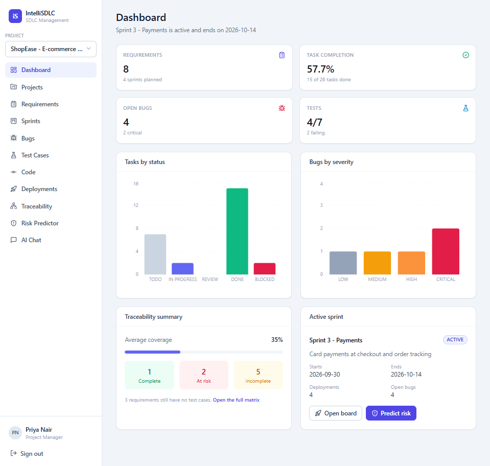
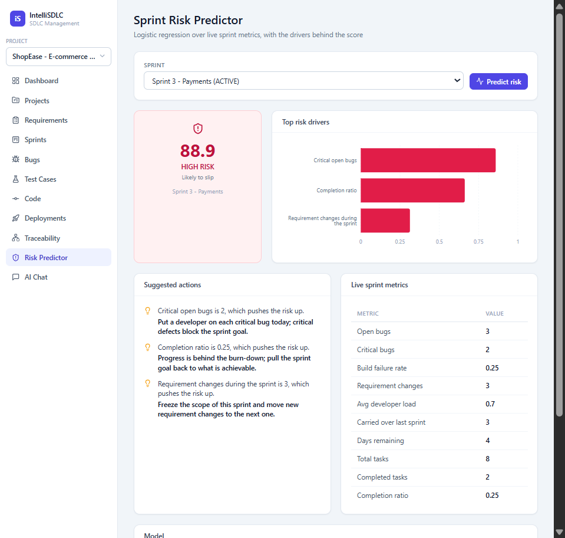
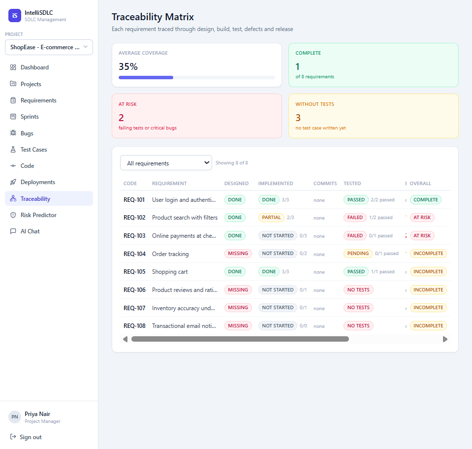

# IntelliSDLC

[](https://github.com/Mihirbhati18/intellisdlc/actions/workflows/ci.yml)
[](LICENSE)

**A software-project management platform that traces every requirement through sprints, tasks, bugs, tests and deployments, and predicts which sprints are likely to slip.**



## Why

In most student and small-team projects, requirements live in one place, tasks in another, bugs in a chat and tests nowhere. Nobody can answer simple questions like *"is REQ-103 actually tested?"* or *"is this sprint going to make it?"* until it is too late. IntelliSDLC links all of it in one model and answers those questions from the data.

## What it does

1. **Sprint Risk Predictor:** a scikit-learn logistic regression over live sprint metrics returns a 0–100 score, a LOW/MEDIUM/HIGH level, the top drivers and a suggested action for each.
2. **Traceability Matrix:** derives Designed / Implemented / Tested / Bugs / Deployed for every requirement straight from the database links, so it can never drift from reality.
3. **Git evidence check:** reads a real git repository, links commits to requirements by their code (`REQ-103 add refund handling`) and flags requirements whose status disagrees with the committed code.
4. **AI Project Agent:** a chat that answers from redacted project data. It uses the Gemini API when a key is set, and otherwise falls back to a built-in offline mode.

Plus full CRUD for projects, requirements (with version history), sprints and a task board, bugs, test cases and deployments, with four roles enforced on the server.

| Risk predictor | Traceability matrix |
|---|---|
|  |  |

## Results

| | |
|---|---|
| Backend tests | **47 pytest tests** (auth, role permissions, versioning, traceability, risk scoring, redaction, AI agent, git sync) |
| UI checks | **128 automated browser checks** across 4 driver scripts, plus **13/13 Selenium test cases** passing ([report](docs/IntelliSDLC_Selenium_Test_Report.pdf)) |
| Risk model | Accuracy **0.735**, F1 **0.71** on 400 held-out sprints (synthetic data, see limits) |
| Setup | Runs fully offline: no API key, no internet, no database server |

## Documents

- [Software Requirements Specification & Work Breakdown Structure](docs/IntelliSDLC_SRS_and_WBS.pdf)
- [Selenium UI test report](docs/IntelliSDLC_Selenium_Test_Report.pdf)
- [Design decisions](docs/DECISIONS.md): why SQLite, why logistic regression, why manual-by-default git sync, and how the build differs from the SRS
- [How it works](docs/how-it-works.html) (open in a browser)

## Honest limits

- The risk model is trained on **2,000 synthetic sprints** generated by a documented process (`backend/ml/train_model.py`), because no real labelled sprint history was available. The pipeline would need retraining on real data before its scores mean anything for a real team.
- It is built for a single team running it locally: SQLite, no deployment, no email notifications.
- Git integration reads a local working copy; it does not call the GitHub API.

## Stack

| Layer | Technology |
|---|---|
| Backend | FastAPI, SQLModel, SQLite, PyJWT, bcrypt, scikit-learn, joblib, pandas, httpx |
| Frontend | React, Vite, TypeScript, Tailwind CSS, React Router, Axios, Recharts, lucide-react |

Roles: `ADMIN`, `PROJECT_MANAGER`, `DEVELOPER`, `QA_ENGINEER`.

### Multiple projects

IntelliSDLC holds any number of projects side by side. The **Projects** page lists them and creates
new ones; the switcher at the top of the sidebar changes which one you are working in, and that
choice is remembered across sign-ins.

Everything else on every page — requirements, sprints, tasks, bugs, test cases, deployments, the
dashboard, the traceability matrix, the risk predictor and the AI chat — is scoped to the open
project, so two projects never see each other's data. A brand new project starts completely empty;
add its requirements and sprints from the usual pages. Only ADMIN and PROJECT_MANAGER can create or
edit a project.

---

## Setup

### 1. Backend (port 8000)

```bash
cd backend
python -m venv .venv
.venv\Scripts\activate          # Windows
# source .venv/bin/activate      # macOS / Linux
pip install -r requirements.txt
copy .env.example .env           # Windows   (cp on macOS / Linux)
python ml/train_model.py         # writes ml/risk_model.pkl + ml/metrics.json
uvicorn app.main:app --reload
```

The database is created and seeded automatically on first start. API docs: <http://127.0.0.1:8000/docs>

To rebuild the demo data from scratch:

```bash
python -m app.seed --reset
```

### 2. Frontend (port 5173)

```bash
cd frontend
npm install
npm run dev
```

Open <http://localhost:5173>. Vite proxies `/api` to the backend on port 8000, so no CORS setup is needed.

### Optional: Gemini

Leave `GEMINI_API_KEY` empty in `backend/.env` and the AI chat runs in offline mode. Add a free key to switch it to Gemini — the AI Chat page shows which mode answered.

## Connecting a git repository

The **Code** page points a project at a git working copy on disk and reads its real commit history.
A commit links to a requirement when its message names the code:

```
git commit -m "REQ-103 add refund handling"
```

Press **Sync** and IntelliSDLC runs `git log`, stores the commits and rebuilds the links. One commit
can name several requirements, and re-syncing rebuilds the links, so correcting a message fixes the
record. The repository is only ever read &mdash; nothing is written or pushed.

Linked commits then appear on the requirement detail page and as a **Commits** column in the
traceability matrix, sitting *beside* the task-based "Implemented" rather than replacing it, so the
gap between work that was ticked off and work that was actually committed stays visible.

A code in the **subject line** counts as work on that requirement. A code that appears only in the
body is a passing mention, recorded as a link but never treated as evidence of work &mdash; so
discussing REQ-103 in a commit about something else cannot move it.

### Manual or automatic

Each repository has a toggle, and **manual is the default**:

| Mode | What a sync does |
|---|---|
| **Manual** | Reads the repository and reports what disagrees. Changes nothing. |
| **Automatic** | Also moves a requirement to `IN_DEVELOPMENT` when its first commit appears, writing the commit into its version history. |

Automatic only ever makes that one transition. A commit proves work started; it does not prove the
work passed its tests or shipped, so nothing is ever auto-marked `TESTED` or `DEPLOYED`.

Either way the **Evidence check** panel on the Code page lists every requirement whose recorded
status disagrees with the committed code &mdash; status sitting behind the commits, or progress
claimed with no commits at all &mdash; and offers a one-click fix for the cases that have an
unambiguous answer. Applying one records who accepted it in the requirement's history.

The demo seeds a repository pointing at IntelliSDLC's own folder, so pressing Sync shows this
project's real history. No token, no network, no GitHub account.

## Tests

```bash
cd backend
pytest -q
```

47 tests run against a temporary SQLite file, so the demo database is never touched. They cover
authentication, the role permissions, the requirement-versioning rule, the three pinned traceability
outcomes, Sprint 3 scoring HIGH and Sprint 4 LOW, context redaction, the offline AI agent, and the
git integration and both status-update modes (which build real throwaway repositories and sync them).

### Driving the UI

`tools/` holds a dependency-free headless-Chrome driver (Node's built-in WebSocket speaking the
DevTools Protocol) that clicks through every page and screenshots it. With the backend and
`npm run dev` already running:

```bash
"C:/Program Files/Google/Chrome/Application/chrome.exe" --headless=new --remote-debugging-port=9222   --user-data-dir=%TEMP%/intellisdlc-chrome about:blank
node tools/drive.mjs          # 84 checks: every page, both roles, screenshots to tools/screenshots
node tools/drive-edge.mjs     # 13 checks: stale token, empty states, a QA write, read-only roles
node tools/drive-projects.mjs # 16 checks: create a second project and prove the data is isolated
node tools/drive-code.mjs     # 15 checks: sync a real repository and check the evidence lands
node tools/drive-offline.mjs  # what the UI shows when the backend is down
```

---

## Demo accounts

Password for all accounts: **`Demo@123`**

| Email | Name | Role |
|---|---|---|
| `admin@intellisdlc.dev` | Mihir Bhati | ADMIN |
| `pm@intellisdlc.dev` | Priya Nair | PROJECT_MANAGER |
| `aarav@intellisdlc.dev` | Aarav Mehta | DEVELOPER |
| `diya@intellisdlc.dev` | Diya Sharma | DEVELOPER |
| `kabir@intellisdlc.dev` | Kabir Singh | DEVELOPER |
| `qa@intellisdlc.dev` | Rahul Verma | QA_ENGINEER |

The login page has one-click buttons for the main accounts.

---

## Five-minute demo

1. **Log in as the PM** (`pm@intellisdlc.dev`) using the quick-fill button. The sidebar switcher shows which project is open.
2. **Dashboard** — KPIs, tasks by status, bugs by severity, traceability summary, active sprint.
3. **Requirements → REQ-103** — open the detail page and show the three-entry **version history** (`HIGH → CRITICAL`, then `APPROVED → IN_DEVELOPMENT`) next to its linked tasks, tests, bugs and deployments.
4. **Sprints → Sprint 3 - Payments** — the board with five status columns; change a card's status from the dropdown.
5. **Risk Predictor** — score **Sprint 3** (comes out **HIGH**, driven by two critical open bugs, a 25% completion ratio and mid-sprint requirement changes), then score **Sprint 4** (**LOW**). Compare the drivers and suggested actions.
6. **Traceability** — REQ-101 is **COMPLETE**, REQ-103 is **AT_RISK**, REQ-106 is **INCOMPLETE** with no tests at all.
7. **Test Cases** — add a test case for **REQ-106**, mark it passed, then reload Traceability to watch its coverage move.
8. **AI Chat** — ask *"Which critical bugs are still open?"* and *"Who is overloaded this sprint?"*; the badge shows Offline mode with the record IDs it used.
9. **Log out and sign in as a developer** (`kabir@intellisdlc.dev`) — the Risk Predictor disappears from the sidebar, and only Kabir's own task cards are editable.

---

## Project layout

```
backend/
  app/
    main.py config.py database.py models.py security.py seed.py
    routers/   auth.py core.py intelligence.py repository.py
    services/  traceability.py risk.py agent.py repository.py
  ml/          train_model.py risk_model.pkl metrics.json
  tests/       test_core.py
  requirements.txt .env.example
frontend/
  src/
    api.ts auth.tsx useFetch.ts App.tsx main.tsx
    components/  Layout.tsx ui.tsx
    project.tsx
    pages/       Login Dashboard Projects Requirements RequirementDetail
                 Sprints SprintBoard Bugs TestCases Deployments
                 Traceability Risk Chat Code
docs/
  DECISIONS.md  IntelliSDLC_SRS_and_WBS.pdf  IntelliSDLC_Selenium_Test_Report.pdf
```

## API summary

Base path `/api/v1`.

| Endpoint | Purpose |
|---|---|
| `GET /health` | Service status, model and AI mode |
| `POST /auth/login`, `GET /auth/me` | Authentication |
| CRUD on `/projects`, `/requirements`, `/sprints`, `/tasks`, `/bugs`, `/test-cases`, `/deployments` | Core records. Every list accepts `?project_id=` |
| `GET /users`, `GET /users/developers` | Team |
| `GET /requirements/{id}/history`, `/links` | Versions and forward links |
| `POST /tasks/{id}/time-logs` | Effort logging |
| `GET /dashboard` | Counts and chart data |
| `GET /traceability` | Traceability matrix |
| `POST /ai/predict-risk` | Sprint risk score, drivers, actions |
| `GET /ai/model-metrics` | Trained model metrics |
| `POST /ai/agent` | Project chat |
| `/repositories`, `/repositories/{id}/sync` | Connect a git folder and read its commits |
| `GET /evidence`, `POST /evidence/apply` | Status-vs-commit disagreements, and accepting one |
| `GET /commits`, `GET /requirements/{id}/commits` | Commits, and the ones naming a requirement |

**Permissions:** ADMIN and PROJECT_MANAGER create and edit everything. DEVELOPER can only change the status of, and log time on, tasks assigned to them. QA_ENGINEER creates and edits bugs and test cases. The risk predictor is ADMIN/PM only. Everyone can read and use the AI chat.

---

## Author

Built by **Mihir Bhati** ([@Mihirbhati18](https://github.com/Mihirbhati18)) as a Software Engineering course project at VIT Chennai. Licensed under [MIT](LICENSE).
